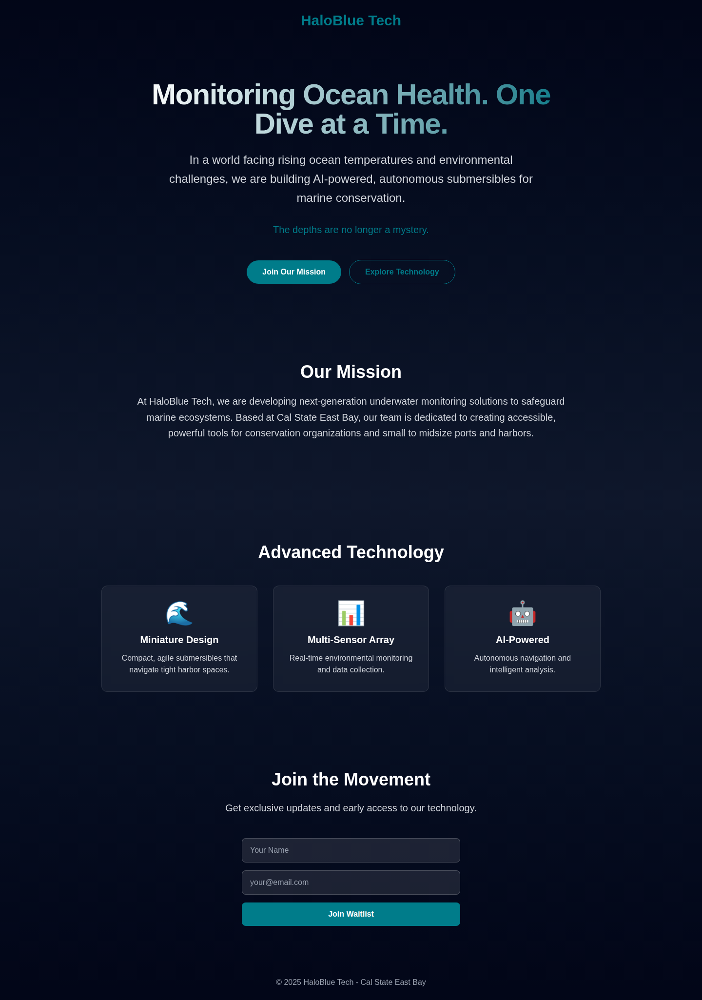

# HaloBlue Tech

[](https://github.com/aneesh-pradhan/halobletech/actions/workflows/ci.yml)

HaloBlue Tech is the marketing site for a Cal State East Bay team building small, AI-powered autonomous submersibles. The page explains why the team is monitoring ocean health for conservation groups and small harbors, and it collects a waitlist for people who want early access.



## Prerequisites

These steps were run from a clean clone on Linux with:

- Node.js 22.23.4 (`node -v`). Next.js 16.1.6 requires Node.js >= 20.9.0.
- npm 10.9.9 (`npm -v`).

No environment variables are required. The app does not read `process.env`.

## Setup

```bash
git clone https://github.com/aneesh-pradhan/halobletech.git
cd halobletech
npm ci
```

`npm ci` installs the exact dependency tree in `package-lock.json` (Next.js 16.1.6, React 19.2.3, and React DOM 19.2.3).

## Run

```bash
npm run dev
```

Open [http://localhost:3000](http://localhost:3000).

## Lint and build

```bash
npm run lint
npm run build
npm start
```

`npm start` serves the production build at [http://localhost:3000](http://localhost:3000).

Continuous integration runs the same install, lint, and build on Node.js 22. See [`.github/workflows/ci.yml`](.github/workflows/ci.yml).

## License

[MIT](LICENSE) © 2026 Aneesh Pradhan
